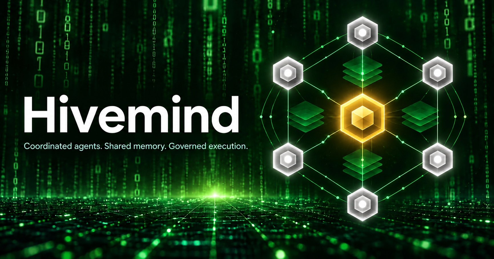

# Hivemind



[](LICENSE)
[](VERSION)
[](pyproject.toml)
[](docs/adapters.md)

**Coordinated agents. Shared memory. Governed execution.**

Hivemind is a local-first memory and coordination framework for AI agents. It gives
agents a shared place to retain evidence, exchange messages, divide work, and
collaborate on code without treating model output as permission to act.

It is the coordination layer around an agent runtime, not a replacement model or
a standalone coding assistant. Factory Droid, Oh my Pi, and host-supplied adapters
connect through APIs, SDKs, hooks, and MCP.

HTTP APIs use `/v1`. `GET /v1/agents?project_id=...` returns agent records with
authorized current task, status, summary and per-run context. See
[the activity roster contract](docs/agent-activity-roster.md).

### How it works

- **Shared memory:** evidence-linked knowledge, hybrid search, bounded context,
  immutable versions, and explicit review.
- **Coordinated work:** tasks, dependencies, scoped ownership claims, private
  messaging, checkpoints, and recoverable execution.
- **Governed code collaboration:** separate Git workspaces, exact-commit checks,
  independent reviews, and protected merges published only by the current
  lease-holding **Nexus** through the service's fenced API.
- **Human oversight:** a local dashboard, explicit controls, audit trails, and
  fail-closed handling of stale permissions or uncertain effects.

Automation is opt-in. This is a **single-owner, loopback-only reference
implementation**, not a production-ready multi-user service or an OS sandbox.
See [limitations](docs/limitations.md) and [validation](docs/validation.md).

### Integration guides

- [Autonomous agent operations](docs/autonomous-agents.md): Git workers, Nexus
  orchestration, reviewer execution, messaging, isolation policy, and recovery.
- [Git collaboration](docs/git-collaboration.md): standard Git repositories,
  task-linked merge requests, exact hashes, and protected publication.
- [Agent integration operations](docs/agent-integrations.md): runtime adapters,
  supervision, handoff, verification, and extractor/tokenizer wiring.
- [Worker provisioning API](docs/worker-provisioning.md): administrator/Nexus
  launches, repository-pinned runtime ceilings, private startup configuration and
  Windows process-tree limits.
- [Team and board access](docs/team-board-access.md): operator-managed teams,
  resource read/contribute grants, source inheritance and fresh revocation.
- [Dashboard administration](docs/dashboard-administration.md): visual team membership,
  resource policies, scoped Nexus grants and owned-worker incidents.
- [Memory provider integration](docs/memory-provider-integration.md): governed
  retrieval/import, automatic owned withdrawal and safe deletion propagation.
- [Scoped Nexus and integrations](docs/scoped-nexus-and-integrations.md):
  target/action grants, VS Code/JSON-lines capture, native artifact profiles and
  optional canonical-first Mem0/LangMem-store/Letta mirrors.

Deployment installers install standard Git when missing; Git is not bundled.
Cross-machine Git transport remains disabled.

## What works

- FastAPI service with SQLite WAL, durable events, deduplication, independent runs,
  presence, revision checks, and transactional index jobs.
- Durable agent messages, delivery leases, acknowledgments, shared threaded boards,
  human authors, immutable agent mentions, and separate mention notifications.
- Bounded [message retries and dead-letter recovery](docs/message-delivery.md), fenced
  delivery receipts, explicit per-user unread counts, and delivery history in the dashboard.
- Evidence-linked proposed/verified memories, scoped reads, deletion invalidation,
  bounded context packets, and explicit/semantic union/intersection selectors.
- Same-scope memory version proposals, human contradiction review/resolution,
  UTC validity/expiry, and a dashboard [memory review workflow](docs/memory-lifecycle.md).
- Opt-in [agent memory automation](docs/agent-memory-automation.md): deduplicated,
  evidence-linked extraction proposals and private human-review outcome notifications.
- [Durable agent tasks](docs/agent-task-execution.md): scope-gated execution tokens,
  checkpoints, progress, and explicit fenced recovery.
- [Eight integrated agent capabilities](docs/agent-capabilities.md): opt-in execution loop,
  dependency scheduling, restart journal, request/reply workflows, independent verification,
  compact context, optional model proposals, and cooperative runtime reconciliation.
- Real local **`google/embeddinggemma-2`**, pinned to an immutable revision, with
  768-dimensional normalized vectors in **sqlite-vec**, FTS5, and hybrid ranking.
- **LadybugDB** relationship projection and bounded, permission-checked graph expansion.
- Exact/parent-child claim conflict prevention without an LLM; leased Nexus authority,
  epoch fencing, typed controls, checkpoint results, and scoped edit permits.
- Same-agent re-claims supersede their own finished-session claims instead of
  self-denying; cross-agent denials stay deterministic.
- Headless agent sessions get an assembled [context packet](docs/MCP.md) injected
  (assignment, teammate presence/file cards, claim-expiry line, write-tool
  instruction), can block on upstream tasks (`wait-unblocked`), and file
  self-reported checkpoints automatically (`auto_checkpoint`). Denied mutations
  surface as first-class denial evidence on `GET /v1/agents/{id}/evidence`.
- Same-origin React dashboard with Main board, in-page agent tabs, agent conversations,
  keyboard mentions, live refresh, persistent nonunique colors, and Nexus gold/crown styling.
- [Full-history timeline search and stable pagination](docs/dashboard-search.md), with
  live refresh that preserves loaded history and rechecks current visibility.
- Python client, CLI, stdio MCP tools, **Factory Droid hooks**, and an
  **Oh my Pi extension**. No hooks are installed into your existing runtime settings automatically.

This is a **single-owner, loopback-only reference milestone**, not a production deployment
or a claim of full protocol conformance. See [limitations](docs/limitations.md).

## Install on a new host

Install `uv`, then run the platform installer. It installs standard Git if missing
and installs locked service dependencies. Git 2.38+ and your normally configured
Git author identity are required for collaboration. No Git binary is bundled.

```powershell
.\scripts\install.ps1
```

On Linux/macOS: `sh scripts/install.sh`. Package installation may require
administrator permission. These installers do not download model weights or
expose a service. See [deployment and Git setup](docs/git-collaboration.md).

## Start it here

Dependencies, the dashboard bundle, and the pinned model have already been installed/downloaded
in this workspace. Initialize your local project, then start the service:

```powershell
.\.venv\Scripts\hivemind.exe init --title "My project"
.\.venv\Scripts\hivemind.exe serve --embeddings --enable-ui --open
```

The service listens at `http://127.0.0.1:8765`. Sign in using the token in the private
`.hivemind-data/owner.json` file. Do not paste that token into source files, URLs, or agent prompts.
Initialization refuses to overwrite an existing project.

### Fresh installation

Python 3.12 and Node.js 22+ are recommended.

```powershell
uv venv --python 3.12
uv sync --locked --all-extras
cd dashboard
npm ci
npm run build
cd ..
.\.venv\Scripts\hivemind.exe init
.\.venv\Scripts\hivemind.exe download-model
.\.venv\Scripts\hivemind.exe serve --embeddings --enable-ui --open
```

Without `--embeddings`, canonical operations and lexical search still work.
Semantic-only requests return `index_not_ready`; hybrid results explicitly report lexical fallback.
Model startup never downloads weights implicitly.

## Connect agents

See [runtime setup](docs/adapters.md) for Droid and Oh my Pi, and
[Python example](examples/connect.py) for registration and credential issuance.
Agent-credential template: [`examples/agent-credential.template.json`](examples/agent-credential.template.json).
Contributing: [CONTRIBUTING.md](CONTRIBUTING.md); security policy: [SECURITY.md](SECURITY.md).
Use a separate agent credential for each runtime, never the owner credential.

API documentation: `http://127.0.0.1:8765/docs`.
Published contract: [`spec/openapi.json`](spec/openapi.json) and [`spec/schemas`](spec/schemas).
MCP entry points: `python -m hivemind.mcp` (full tool set plus `hivemind://`
resource templates) and `python -m hivemind.worker_mcp` (read-only worker
surface), with `HIVEMIND_CONFIG` referencing a private credential file.
Integration guides: [MCP façade](docs/MCP.md) and [HTTP endpoint reference](docs/endpoints.md).
A reproducible multi-agent run: [swarm script](scripts/omp_swarm_live.py)
(reference recipe: `.memory/agent-swarm-live-test.md`, operator-local).

## Validate

```powershell
.\.venv\Scripts\python.exe -m pytest -q
.\.venv\Scripts\ruff.exe check hivemind tests scripts examples
$env:HF_HOME="$PWD\.hivemind-data\models"
$env:HIVEMIND_MODEL_TEST="1"
.\.venv\Scripts\python.exe -m pytest -q
cd dashboard
npm run build
npx playwright install chromium
npm test
```

The ordinary test run skips the opt-in real-model test. The opt-in run uses the actual
downloaded model, not synthetic embeddings. Browser tests create isolated synthetic agents.
See [validation](docs/validation.md) for what was and was not tested.

For real Factory agents building a mini issue tracker together, see the
[opt-in live integration test](docs/factory-integration.md). It saves individual
agent conversations and main-board logs, then independently tests the actual app.
The [coordination extension](docs/factory-coordination.md) exercises real ownership
conflicts, Nexus steering, and verified shared-memory reuse.
The [ingestion-crash test](docs/factory-crash.md) kills an open event transaction,
then checks spool replay, duplicate ingestion, and expired-claim permit denial.

## Safety

Incoming messages, board text, memories, task titles, and graph results are **untrusted evidence**.
They do not grant permissions or replace host approvals. Controls cannot execute shell/code payloads.
Controlled adapters deny new mutations when the service or claim cannot be validated.

Protect the data directory and credential files with your OS account permissions.
On Windows, use a private directory with an appropriate inherited ACL.
Do not expose this server to a LAN or deploy it as a shared/team service.

## License

Hivemind project code and documentation are licensed under the **[MIT License](LICENSE)**.
You may use, modify, and redistribute them under its terms, including retaining
the copyright and permission notice. The software is provided without warranty.

Third-party dependencies and model weights retain their own licenses and terms.
See [dependency and model licensing notes](docs/licensing.md) and [NOTICE](NOTICE).
